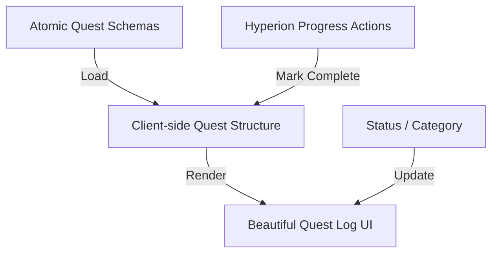

# wax-on-chain-quest-log — On-Chain Quest Log & Achievement Tracker

> **Status:** 🔒 Private (In Development) | Target Public Release: August 2026  
> **Category:** Interactive On-Chain Storytelling & Narrative Engines / Gaming Crossover  
> **Parent Catalog:** [pixel-journey/wax-ecosystem-blueprint-catalog](https://github.com/pixel-journey/wax-ecosystem-blueprint-catalog)

**One-sentence goal:** A beautiful, interactive quest log and achievement tracker that parses on-chain progress, completed tasks, rewards, and narrative milestones for gaming and story-driven projects on WAX.

---

## 1. Overview & Goal

This blueprint turns on-chain activity into a living quest log that feels like a premium game journal. Players see their journey beautifully visualized with clear progress and rewards.

- **Why it matters for WAX:** Gaming and narrative projects thrive on progression. A beautiful quest log increases engagement, motivation, and the emotional connection to the world.
- **Public infrastructure only:** AtomicAssets for quests/rewards, Hyperion for progress actions, client-side rendering. No custom contracts.
- **Target users:** Gaming project creators, players tracking progress, narrative game designers, achievement hunters.
- **Success metrics:** "See my full quest progress and achievements in a beautiful log in <3s", "Clear sense of progression and rewards", "Shareable completed quests with on-chain proof".

---

## 2. Concepts & Inspiration

- **Core concepts:** Quests and achievements are defined in schemas or mutable data. On-chain actions (transfers, burns, interactions) mark progress. Client aggregates and displays in an elegant journal-style UI with filters and completion states.
- **Pain points:** Most on-chain progress is hidden in transaction lists. Players want a beautiful, game-like overview of what they've accomplished.
- **Inspirations:** Game quest logs (e.g. in RPGs), achievement trackers in modern games, beautiful journal UIs. Web3: on-chain provenance for every completed quest.
- **Cross-references:** Perfect with `wax-on-chain-narrative-timeline`, `wax-branching-choose-your-own-adventure`, and gaming/metagame blueprints. Complements performance and analytics tools.

---

## 3. Design Specifications (Pixel Journey Standards)

### 3.1 Visual & Interaction Design
- Clean, journal-like or game-log aesthetic with elegant typography and subtle illustrations.
- Main view: List or grid of quests with completion status, progress bars, and reward previews.
- Interactions: Click to expand details, filter by status (active/completed/hidden), search.
- Micro-interactions: Satisfying checkmark animations on completion, gentle highlight on new rewards.
- Responsive: Beautiful on desktop; clean mobile list view.

### 3.2 Key Views / Components
- `QuestLog.tsx` — Main interactive quest log.
- `QuestCard.tsx` — Rich card showing title, description, progress, and rewards.
- `AchievementGallery.tsx` — Beautiful grid or wall of unlocked achievements.
- `ProgressFilters.tsx` — Filters for active, completed, by category.
- `ShareableQuest.tsx` — Export completed quest or achievement with on-chain proof.

### 3.3 Accessibility (A11y) & Inclusive Design
- WCAG 2.2 AA: Keyboard navigation, screen reader support for quest states, high contrast.
- Clear status indicators with text labels.
- Option for simple list view.

### 3.4 Performance & Optimization Targets
- Fast initial load with cached progress data.
- Efficient filtering and rendering even with many quests.
- Smooth animations without performance cost.

---

## 4. Technical Architecture

### 4.1 Core Tech Stack
- Next.js 15 + TypeScript + Tailwind + shadcn/ui + framer-motion
- @tanstack/react-query for quest and progress data
- AtomicAssets + Hyperion for quest definitions and completion actions
- date-fns for timeline elements

### 4.2 Data Flow Diagram (Mermaid)


### 4.3 Folder Structure
```
app/
├── (questlog)/[projectId]/page.tsx
├── components/
│   ├── quest/
│   │   ├── QuestLog.tsx
│   │   └── QuestCard.tsx
│   ├── achievement/
│   │   └── AchievementGallery.tsx
│   └── filters/
│       └── ProgressFilters.tsx
├── hooks/useQuestLog.ts
├── lib/wax/
│   ├── quest-parser.ts
│   └── progress-tracker.ts
└── types/quest.ts
```

### 4.4 Security & Privacy
- Purely public data. Optional shareable completed quests contain only public summaries + proof links.

---

## 5. Implementation Examples & Code Snippets

**Core quest log hook**
```ts
// hooks/useQuestLog.ts
export function useQuestLog(projectId: string) {
  return useQuery({
    queryKey: ['quest-log', projectId],
    queryFn: async () => {
      const quests = await fetchQuestDefinitions(projectId);
      const progress = await fetchProgress(projectId);
      return mergeProgress(quests, progress);
    }
  });
}
```

**Quest card rendering**
```tsx
<QuestCard
  quest={quest}
  progress={progress[quest.id]}
  onClick={() => showDetails(quest)}
/>
```

---

## 6. Demo & Testing Strategy
- Demo mode with rich sample quests and progress.
- Live mode with real gaming/narrative projects.
- Interaction tests: filter, expand, share completed quests.
- Edge cases for hidden quests and complex progress tracking.

---

## 7. Roadmap & Development Phases
**Phase 0-1:** Quest definition parsing + progress tracking layer.
**Phase 2:** Core quest log UI with beautiful cards and filters.
**Phase 3:** Achievement gallery, shareable moments, polish.
**Phase 4:** Full documentation and catalog update.

**Future:** Integration with narrative timeline, on-chain quest sharing, leaderboards.

---

## 8. Visual References & Mockups
> Beautiful game quest logs like those in modern RPGs or narrative games, but with on-chain provenance and premium Web3 polish. Elegant cards, clear progress, satisfying completion states. Reference: high-quality game journal UIs.

---

## 9. Related Blueprints & Ecosystem Fit
- `wax-on-chain-narrative-timeline` & `wax-branching-choose-your-own-adventure` — Narrative + quest synergy.
- Gaming and metagame blueprints for deeper progression systems.

---

## 10. License & Credits
- MIT License
- Built for beautiful on-chain quest and achievement experiences on WAX.
- Thanks to Atomic Hub and Hyperion for reliable public data.
- Pixel Journey Design System for consistent beautiful components.

**This blueprint turns on-chain progress into a living, beautiful quest journal you can be proud of.**

---

**Pixel Journey — Beautiful interfaces for public blockchain data.**
